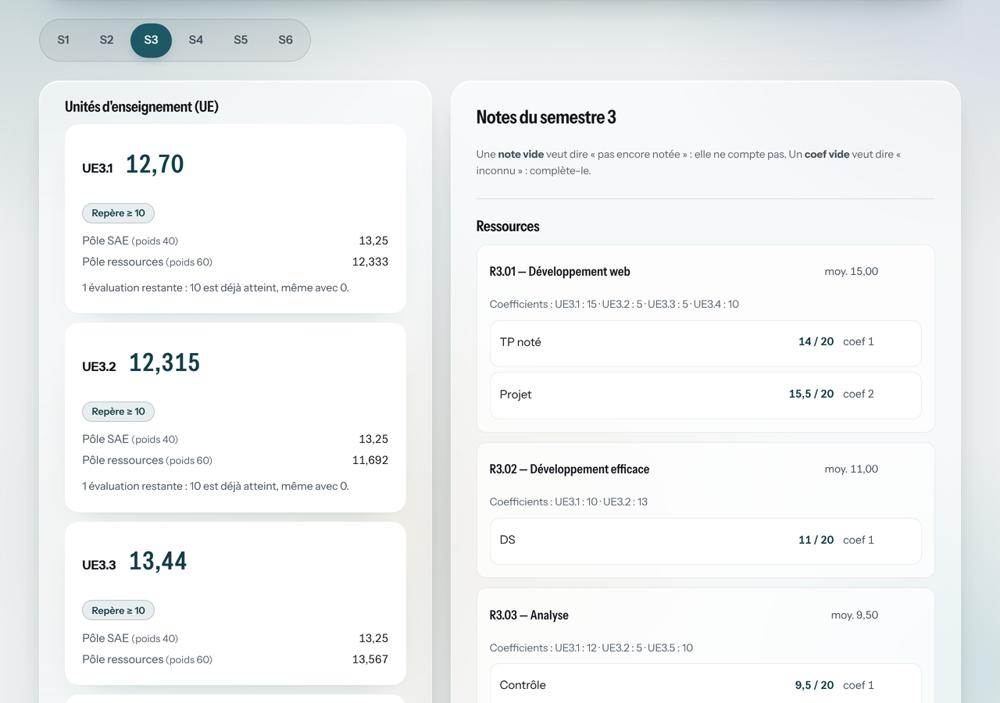
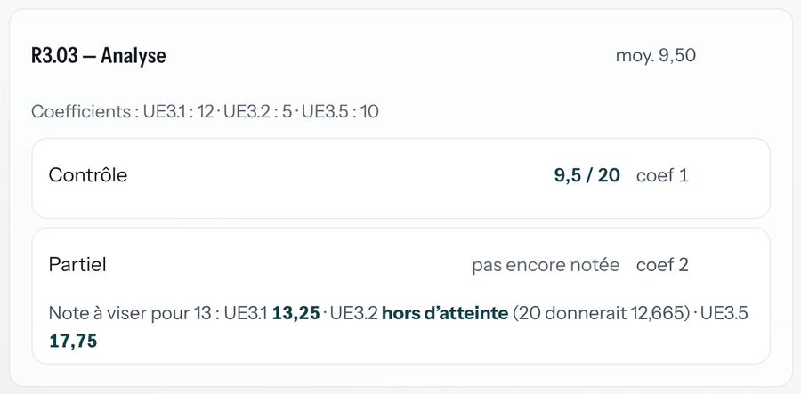

# simulateur-but

[](https://github.com/angele-os/simulateur-but/actions/workflows/tests.yml)
[](https://github.com/angele-os/simulateur-but/actions/workflows/deploiement.yml)

[Français](#français) · [English](#english)

## Français

Simulateur de moyennes du **BUT Informatique de l'IUT de Metz** : il calcule les moyennes des ressources, des pôles, des UE et des compétences, puis la **note à viser** pour atteindre 10. Il peut lire directement les PDF de l'ENT, **dans le navigateur**, sans jamais envoyer ni stocker la moindre note.

**Démo : <https://notes.ange-bonkoski.fr>**

HTML, CSS et JavaScript sans framework. Une seule dépendance : [pdf.js](https://mozilla.github.io/pdf.js/), servie par le site lui-même.



### Pourquoi ce projet

Chaque semestre, la même question revient : « quelle note dois-je avoir au prochain partiel pour valider l'UE ? ». Y répondre à la main demande de connaître les coefficients de chaque évaluation, de chaque ressource et de chaque pôle, puis de refaire tout le calcul. L'outil le fait à partir du relevé que l'ENT fournit déjà.

C'est aussi un exercice de sécurité : l'outil manipule des **données personnelles** (relevé de notes, nom, n° d'étudiant) et doit lire des **fichiers PDF venus de l'extérieur**. Il doit donc rester sûr même face à un PDF piégé.

### Fonctionnalités

#### Choix de l'année

- BUT1 (tronc commun), BUT2 et BUT3 en parcours **RA** ou **DACS**.
- Les **coefficients officiels** de l'IUT de Metz sont intégrés : les semestres, les UE, les ressources et les SAE se créent tout seuls.

#### Saisie et import

- **Saisie manuelle** : elle fonctionne toujours, sans aucun import.
- **Import du relevé « Détail des notes »** de l'ENT (PDF) : les notes et les coefficients des évaluations sont pré-remplis.
- **Import du tableau des coefficients** (PDF), si l'IUT en publie un nouveau.
- Un import ne fait que **pré-remplir** : tout reste modifiable, ajoutable et supprimable.
- Si l'import ne comprend pas une partie, il le dit, et **n'invente jamais de valeur** : un coefficient illisible (`Coef ??`) est demandé.

#### Calculs

- Moyenne de chaque ressource et de chaque SAE, à partir des coefficients des évaluations.
- **Pôle Ressources** et **pôle SAE** de chaque UE, puis **moyenne de l'UE**, avec le malus du semestre s'il y en a un.
- **Moyenne de chaque compétence** sur l'année (par exemple UE3.1 et UE4.1 donnent la compétence 1).
- UE **provisoire** quand un pôle n'a encore aucune note.
- **Calculé et officiel côte à côte** quand le relevé donne la moyenne officielle, avec les écarts signalés.
- **Note à viser** pour une évaluation pas encore passée : la note minimale pour que l'UE atteigne 10 (ou une autre cible). L'outil indique aussi quand la cible est déjà atteinte, ou impossible même avec 20.



> **Les résultats sont indicatifs.** Seul le relevé officiel fait foi. L'outil n'affiche aucun verdict (« admis », « ajourné ») : les règles de compensation ne sont pas encore intégrées.

#### Précision

Les règles de calcul ont été établies à partir des vrais documents de l'IUT, puis vérifiées sur de vrais relevés : **23 moyennes officielles sur 24** sont retrouvées exactement. L'écart restant vient d'un coefficient appliqué par l'IUT différent de celui écrit dans le relevé ; l'outil le signale. Le détail des règles, et des pièges des PDF (pages tournées de 90°, codes collés aux intitulés, arrondi au millième), est dans [docs/FORMAT-PDF.md](docs/FORMAT-PDF.md).

#### Interface

- En français, utilisable sur téléphone.
- Navigation au clavier, libellés pour les lecteurs d'écran, contraste vérifié.

### Données personnelles

- **Rien n'est envoyé** : aucune requête réseau, interdite par la CSP (`connect-src 'none'`).
- **Rien n'est stocké** : ni cookie, ni `localStorage`, ni base de données. Tout disparaît à la fermeture de l'onglet.
- **L'en-tête du relevé n'est jamais lu** : le nom, le n° de dossier, l'INE et l'e-mail sont ignorés.
- **Aucune vraie donnée dans le dépôt** : les tests n'utilisent que des relevés inventés.

Des tests automatiques vérifient chacune de ces règles. Par exemple, ils échouent si `fetch` ou `localStorage` apparaissent dans le code.

### Sécurité

- **PDF piégé** : taille (5 Mo), nombre de pages (10) et durée de lecture (15 s) limités, `isEvalSupported: false` contre la CVE-2024-4367 de pdf.js, polices du PDF jamais chargées, lecture dans un worker détruit après chaque import.
- **Injection** : aucun HTML construit à partir d'un PDF ou d'une saisie (`textContent` uniquement), CSP stricte sans `unsafe-inline` ni `unsafe-eval`, **Trusted Types** avec une seule politique, limitée à l'adresse exacte du worker de pdf.js.
- **Chaîne d'approvisionnement** : une seule dépendance, copiée dans le dépôt (aucun CDN), versions verrouillées, et un test qui vérifie que la copie servie est à jour.
- **Publication** : le site n'est publié que si tous les tests passent, et seulement une liste blanche de fichiers. Actions GitHub épinglées par empreinte SHA, droits minimaux, aucun secret.

Le modèle de menace complet, avec les limites connues, est dans [SECURITY.md](SECURITY.md). Pour signaler une faille, merci d'utiliser le [signalement privé de GitHub](https://github.com/angele-os/simulateur-but/security/advisories/new), jamais une issue publique, et sans joindre de vrai relevé.

### Lancer le projet en local

Prérequis : Node.js 24 ou plus récent.

```sh
git clone https://github.com/angele-os/simulateur-but.git
cd simulateur-but
npm ci        # installe exactement les versions du package-lock.json
npm test      # lance les 249 tests
```

Pour ouvrir l'app, il faut un petit serveur web local (les modules JavaScript ne se chargent pas depuis un simple fichier), par exemple l'extension Live Server de VS Code.

| Commande | Rôle |
|---|---|
| `npm test` | Lance tous les tests (`node:test`). |
| `npm run vendor` | Recopie pdf.js dans `vendor/pdfjs/` après une mise à jour. |
| `npm run referentiel` | Régénère les coefficients intégrés à partir des tableaux officiels (en local, PDF dans `prive/`). |
| `npm run verifier` | Compare les moyennes calculées et officielles sur de vrais relevés (en local, n'affiche que des codes et des nombres). |

Les tests couvrent les calculs, la lecture des deux types de PDF (sur des données inventées), le modèle de données, l'édition, les règles de sécurité de la page et la configuration de la CI.

### Contribuer

Voir [CONTRIBUTING.md](CONTRIBUTING.md), notamment la procédure quand Dependabot propose une nouvelle version de pdf.js.

### Licence

Code distribué sous licence MIT : voir [LICENSE](LICENSE). pdf.js est distribué sous licence Apache 2.0 ([vendor/pdfjs/LICENSE](vendor/pdfjs/LICENSE)), la police Instrument Sans sous SIL Open Font License 1.1.

Outil personnel et non officiel, sans lien avec l'IUT de Metz ni l'Université de Lorraine.

---

## English

Grade simulator for the **BUT Informatique** (a French three-year bachelor's in computer science) at IUT de Metz. It computes the averages of each module, each teaching unit (UE) and each competency, then the **grade needed** on an upcoming exam to reach 10/20. It can read the school's PDF transcripts **directly in the browser**, without ever sending or storing any grade.

**Demo: <https://notes.ange-bonkoski.fr>** (French interface).

Plain HTML, CSS and JavaScript, no framework. One dependency only: [pdf.js](https://mozilla.github.io/pdf.js/), self-hosted.

### Highlights

- **Official coefficients built in** for all three years and both specialisations (RA and DACS).
- **Manual entry always works**; PDF import only pre-fills fields, and never guesses a value it cannot read.
- **Calculated vs official** averages shown side by side; the rules reproduce **23 of 24 official averages** exactly on real transcripts.
- **Privacy by design**: no network request (`connect-src 'none'`), no storage, the transcript header (name, student ID, email) is never read, and tests enforce each of these rules.
- **Hardened against malicious PDFs**: size, page and time limits, `isEvalSupported: false` (CVE-2024-4367), parsing in a worker, strict CSP with Trusted Types.
- **249 tests**; the site is only deployed when they all pass. Threat model in [SECURITY.md](SECURITY.md).

### Running the tests

```sh
git clone https://github.com/angele-os/simulateur-but.git
cd simulateur-but
npm ci
npm test
```

### License

MIT, see [LICENSE](LICENSE). Unofficial personal tool, not affiliated with IUT de Metz or Université de Lorraine.
